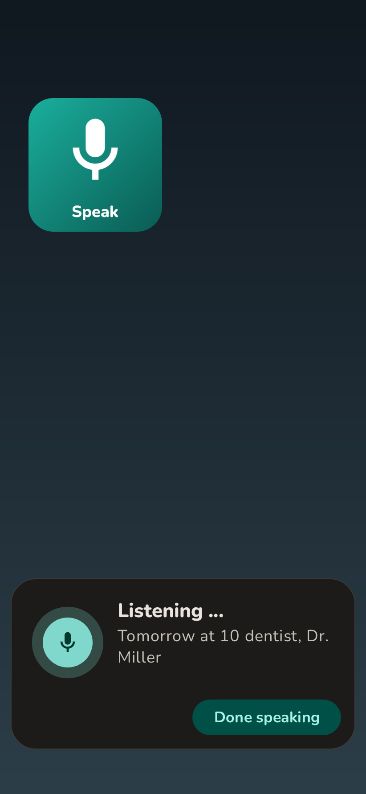
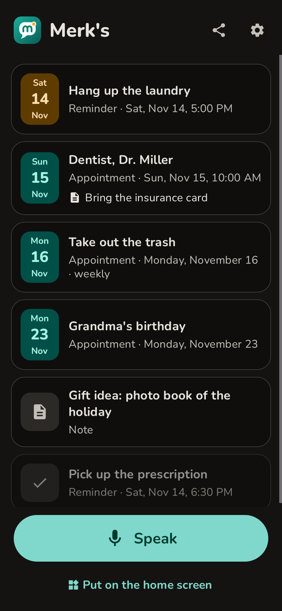
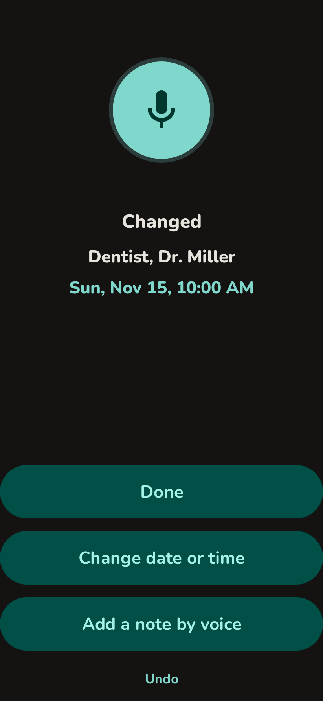
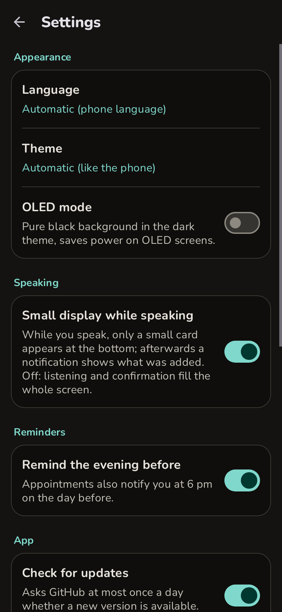

# Merk's

Tap once, say it, done. Merk's is an Android app for people who do not want to open an app, type, or think about where something belongs.

A home screen widget starts listening right away. What you say becomes an appointment, a reminder or a note. Appointments go into your calendar, and the app reminds you in time. Merk's speaks English and German.

  
  
  
  

## Install

Download `merks.apk` from the [latest release](https://github.com/Silvertax/merks/releases/latest) and open it. Updates install over older versions; your entries are kept. To look for a new version, tap “Check for updates now” in the settings; “Update now” then downloads it and opens the phone's installer. The first time, the phone asks you to allow Merk's to do that.

## How it works

1. Tap the widget or the "Speak" button in the app.
2. Say what you want to remember, for example "Tomorrow at 10 dentist" or "Remind me in 20 minutes to take the laundry out".
3. A notification shows what was saved. "Undo" removes it again.

Take your time: a pause to think does not end the recording. Merk's keeps listening and saves after about three seconds of silence, or when you tap "Done speaking". If you need longer, choose a long pause in the settings (Pauses while speaking).

Something goes with an appointment, like what to bring? Tap "Add note" on the confirmation, or tap the entry and then "Add a note by voice", and say it. The note shows below the appointment, in the calendar and in the reminder. A note you already spoke on its own can join an appointment too: tap it and choose "Add to an appointment".

Forgot the date, or said the wrong time? Tap "Change" on the confirmation, or tap the entry in the app and then "Change date or time", and just say the new one, for example "Friday at 10". The title stays; the calendar entry and the reminders move along. A note that gets a date becomes an appointment.

Prefer typing, or a word was understood wrongly? Tap the entry and then "Edit by typing": there you correct the text and the note, and pick the day and time.

Repeating things work too: "Every Monday take out the trash", "Every weekday at 7 am walk the dog", "Every other Wednesday choir at 6 pm", "Every year on December 3rd grandma's birthday". They become repeating calendar events.

Time spans and several days work as well: "Tomorrow from 10 to 12 handyman", "December 20 to 23 grandma visits".

Reminders come on time, appointments one hour ahead and, if you like, also the evening before. Each reminder has "Done", "In 15 min" and "In 1 hr" buttons.

The widget can be resized from 2x2 down to 1x1. A second widget, "Up next", shows on your home screen what comes next, and a tap on it opens the list with everything. It starts two cells wide, so it fits next to the "Speak" button as a second big button; made taller, it also lists the two entries after it. "Put on the home screen" in the app offers both.

The list shows only what is current: what is still to come at the top, soonest first, then your notes. Appointments and reminders whose time is over leave the app by themselves; appointments stay in your calendar. Everything with a date shows the weekday, day and month up front, so you find a date at a glance. The share button at the top passes on everything that is coming up as plain text, for example to a family chat; a single entry can be shared from its details. If you like, a quiet notification shows it on the lock screen too (Settings → Always show what's next).

The theme is light, dark or follows your phone, and an OLED mode makes the dark theme pure black.

## Language

German phones get German, all others English. You can also choose the language in the settings (on Android 13 and newer also in the system's app language settings). Speech recognition follows the app's language.

## Understanding what you say

- **Built in:** common date, time and repeat phrases in English and German are understood offline, without any account.
- **With AI (optional):** with your own Anthropic API key, Merk's also understands free-form speech. You can choose the model; the settings show whether key and model work. Without internet, the built-in rules take over.

## Privacy

No ads, no tracking, no account. Your entries stay on your phone and in your calendar, unless you share them yourself.

- Speech recognition is done by the recognizer installed on your phone.
- Only when you tap "Check for updates now" in the settings, the app asks GitHub for the latest version, and only on "Update now" it downloads that version from the GitHub release. No personal data is sent.
- Only if you enter an AI key, the spoken text is sent to Anthropic to be sorted.

## Status

Merk's is young and still growing. Ideas and problems are welcome as an [issue](https://github.com/Silvertax/merks/issues).

## License

MIT, see [LICENSE](LICENSE). The Nunito font is licensed under the SIL Open Font License, see [fonts/Nunito-OFL.txt](fonts/Nunito-OFL.txt).
