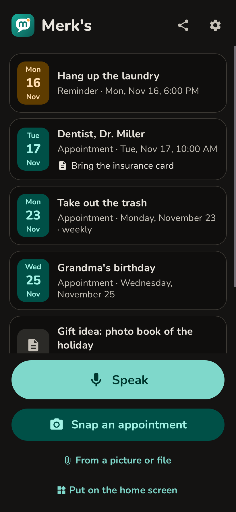
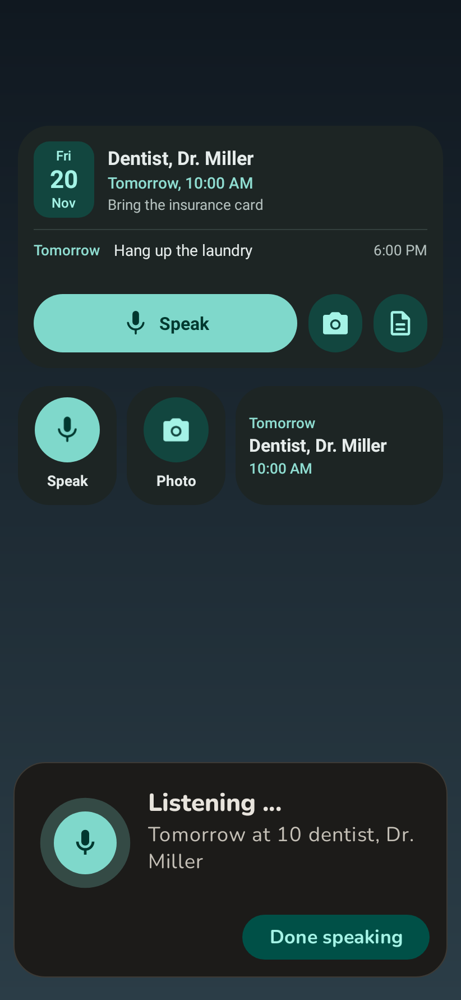
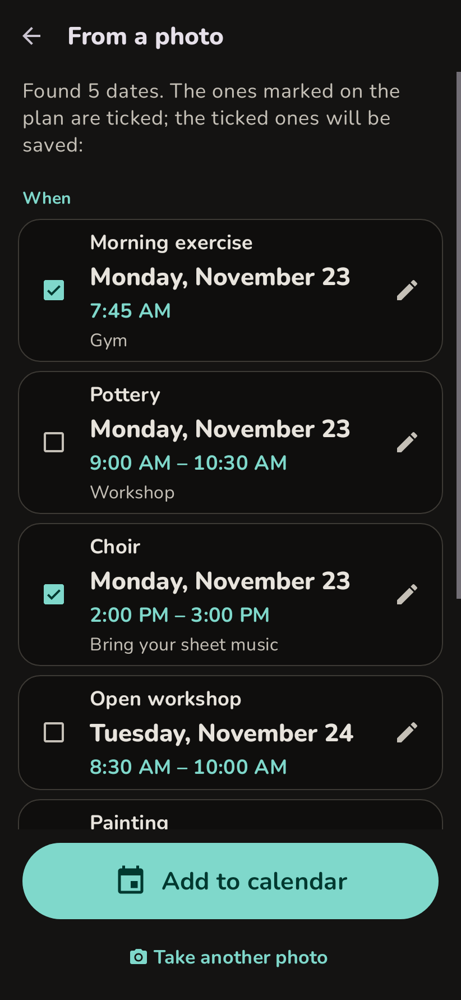
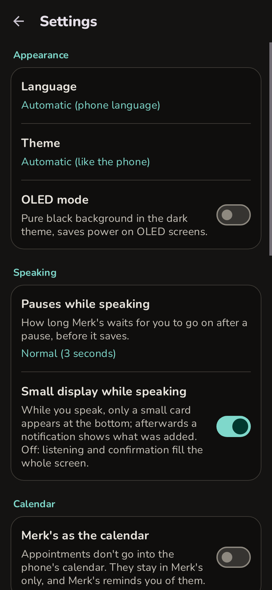

# Merk's

A simple calendar you talk to. Tap once, say it, done: Merk's is an Android app for people who do not want to open an app, type, or think about where something belongs.

A home screen widget starts listening right away. What you say becomes an appointment, a reminder or a note, and Merk's reminds you in time. A letter or an appointment card can simply be photographed. Merk's fills your phone's calendar, or it is your calendar itself: then appointments stay in Merk's only, and you choose when it reminds you of them. Merk's speaks English and German.

  
  
  
  

## Install

Download `merks.apk` from the [latest release](https://github.com/Silvertax/merks/releases/latest) and open it. Updates install over older versions; your entries are kept. To look for a new version, tap “Check for updates now” in the settings; “Update now” then downloads it and opens the phone's installer. The first time, the phone asks you to allow Merk's to do that.

## How it works

1. Tap the widget or the "Speak" button in the app.
2. Say what you want to remember, for example "Tomorrow at 10 dentist" or "Remind me in 20 minutes to take the laundry out".
3. A notification shows what was saved. "Undo" removes it again.

Take your time: a pause to think does not end the recording. Merk's keeps listening and saves after about three seconds of silence, or when you tap "Done speaking". If you need longer, choose a long pause in the settings (Pauses while speaking).

Something goes with an appointment, like what to bring? Tap "Add note" on the confirmation, or tap the entry and then "Add a note by voice", and say it. The note shows below the appointment, in the calendar and in the reminder. A note you already spoke on its own can join an appointment too: tap it and choose "Add to an appointment".

Forgot the date, or said the wrong time? Tap "Change" on the confirmation, or tap the entry in the app and then "Change date or time", and just say the new one, for example "Friday at 10". The title stays; the calendar entry and the reminders move along. A note that gets a date becomes an appointment.

Prefer typing, or a word was understood wrongly? Tap the entry and then "Edit by typing": there you correct the text and the note, and pick the day and time.

## Appointments from a photo

Got a letter or an appointment card? Tap "Snap an appointment" in the app or the "Photo" widget, and take a photo of it. Merk's reads the date, the time and what it is about, and shows it to check: change the title, the day or the time, and add a note, then "Add to calendar" ("Save" when Merk's is the calendar). A card with several treatments gives several appointments; untick the ones you don't want. The letter's own date, birthdays and dates that are over are left out. If no date was found, you can pick it yourself.

The photo is not kept: it is deleted as soon as it has been read, and it never lands in your gallery from Merk's. Only the line the date came from stays with the entry, so you can see later where it was read.

Without an AI key, the phone reads the photo itself (Tesseract, built in). That works well for printed text; handwriting it can hardly read. With an AI key, the AI reads the photo, handwriting included; without internet, the phone reads it itself.

## Appointments from a picture, a file or a message

Someone sent you the appointment as a picture, a PDF or a message? In that app tap "Share" and pick Merk's: it is read like a photo and shown to check the same way. The other way round works too: "From a picture or file" in Merk's opens a picture, a PDF or a calendar file from the phone.

- **Pictures and PDFs** are read like photos; of a PDF, the first three pages, together.
- **Calendar files** (.ics), as booking pages and invitations send them, are taken over exactly: title, place, start and end, a series as a series. Tapping such a file in a mail can open it in Merk's too.
- **Messages** are searched for dates like a letter; a short one like "tomorrow at 10 dentist" is understood like something said.
- **Weekly plans** with a column for each day, as for courses, groups or treatments, become all their appointments, each with its own title and the room in its note. What is marked with a highlighter is ticked. The phone reads the columns itself; with an AI key the AI reads the plan, also one written by hand.

Merk's reads a copy and deletes it afterwards; the original stays where it is. The entry notes that it was taken from a file or message.

## Calendar and reminders

Appointments go into your phone's calendar, so you see them there too. For anyone who keeps their appointments in Merk's and never opens the phone's calendar: switch on Settings → Merk's as the calendar. Appointments then stay in Merk's only, and Merk's reminds you of them. The appointments already in the phone's calendar can be taken out of it in the same step, so the calendar app does not remind you as well. Switched off again, the appointments that are only in Merk's can go into the calendar.

Reminders come on time. For appointments you choose when (Settings → Remind me of appointments): a week, a day or two hours ahead, the evening before at 6 pm, an hour, 30 or 15 minutes ahead, when it starts, or several of these. Out of the box it is the evening before and an hour ahead; all-day appointments remind at 8 in the morning. Each reminder has "In 15 min" and "In 1 hr" buttons, and "Done" for a reminder or "OK" for an appointment: "OK" puts away only this notification, so the reminders still to come for the appointment come all the same.

## Widgets

Four widgets for the home screen; "Put on the home screen" in the app offers them all.

- **All in one:** what comes next, with its date tile as in the list, and below it the buttons "Speak" and "Photo". It starts four cells wide and two high; made taller it also lists the entries after it, and one row high the buttons turn round and sit beside it.
- **Speak** and **Photo:** one big round button each, from 2x2 down to 1x1.
- **Up next:** what comes next, with the date tile when there is room for it; made taller it also lists the two entries after it. A tap on it opens the list with everything.

The widgets follow the phone's light or dark mode, and they adapt to their size and to larger print, so nothing is cut off. A tap anywhere else on "All in one" opens the list too.

## More

Repeating things work too: "Every Monday take out the trash", "Every weekday at 7 am walk the dog", "Every other Wednesday choir at 6 pm", "Every year on December 3rd grandma's birthday". They become repeating appointments, in the phone's calendar as a series.

Time spans and several days work as well: "Tomorrow from 10 to 12 handyman", "December 20 to 23 grandma visits".

The list shows only what is current: what is still to come at the top, soonest first, then your notes. Appointments and reminders whose time is over leave the app by themselves; appointments stay in your calendar, unless Merk's is the calendar. Everything with a date shows the weekday, day and month up front, so you find a date at a glance. The share button at the top passes on everything that is coming up as plain text, for example to a family chat; a single entry can be shared from its details. If you like, a quiet notification shows it on the lock screen too (Settings → Always show what's next).

The theme is light, dark or follows your phone, and an OLED mode makes the dark theme pure black.

## Language

German phones get German, all others English. You can also choose the language in the settings (on Android 13 and newer also in the system's app language settings). Speech recognition follows the app's language.

## Understanding what you say and photograph

- **Built in:** common date, time and repeat phrases in English and German are understood offline, without any account. Photos are read on the phone.
- **With AI (optional):** with your own Anthropic API key, Merk's also understands free-form speech and reads photos better, handwriting included. You can choose the model; the settings show whether key and model work. Without internet, the built-in rules and the reading on the phone take over.

## Privacy

No ads, no tracking, no account. Your entries stay on your phone and in your calendar, unless you share them yourself.

- Speech recognition is done by the recognizer installed on your phone.
- Only when you tap "Check for updates now" in the settings, the app asks GitHub for the latest version, and only on "Update now" it downloads that version from the GitHub release. No personal data is sent.
- Photos, and copies of pictures, files and messages passed on to Merk's, are read on the phone and deleted right after. Only if you enter an AI key, the spoken text, the photo or what was passed on is sent to Anthropic to be sorted and read; calendar files never are.

## Status

Merk's is young and still growing. Ideas and problems are welcome as an [issue](https://github.com/Silvertax/merks/issues).

## License

MIT, see [LICENSE](LICENSE). The Nunito font is licensed under the SIL Open Font License, see [fonts/Nunito-OFL.txt](fonts/Nunito-OFL.txt). The symbols in the widgets are [Material Symbols](https://github.com/google/material-design-icons) by Google (Apache License 2.0).

Reading photos on the phone uses [Tesseract](https://github.com/tesseract-ocr/tesseract) and its [recognition data](https://github.com/tesseract-ocr/tessdata_fast) (Apache License 2.0) and [Leptonica](http://www.leptonica.org/) (BSD 2-Clause), built for Android by [Tesseract4Android](https://github.com/adaptech-cz/Tesseract4Android) (Apache License 2.0).
