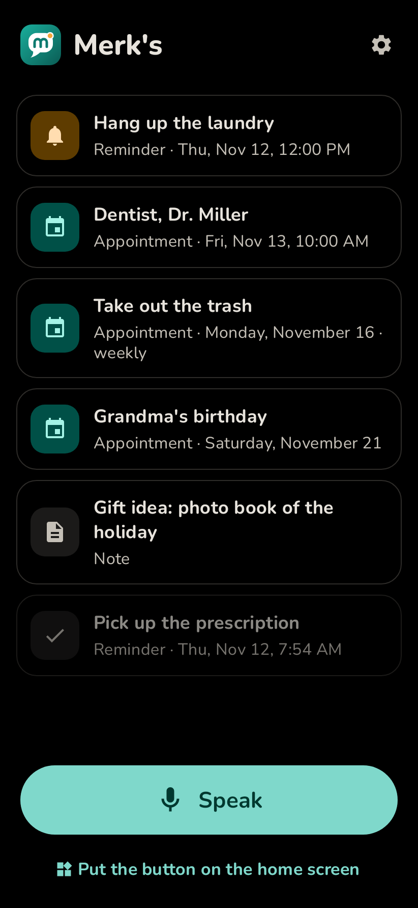

# Merk's

Tap once, say it, done. Merk's is an Android app for people who do not want to open an app, type, or think about where something belongs.

A home screen widget starts listening right away. What you say becomes an appointment, a reminder or a note. Appointments go into your calendar, and the app reminds you in time. Merk's speaks English and German.

  
  
  
  

## Install

Download `merks.apk` from the [latest release](https://github.com/Silvertax/merks/releases/latest) and open it. Updates install over older versions; your entries are kept. The app tells you when a new version is out.

## How it works

1. Tap the widget or the "Speak" button in the app.
2. Say what you want to remember, for example "Tomorrow at 10 dentist" or "Remind me in 20 minutes to take the laundry out".
3. A notification shows what was saved. "Undo" removes it again.

Repeating things work too: "Every Monday take out the trash", "Every day at 8 am take pills", "Every year on December 3rd grandma's birthday". They become repeating calendar events.

Reminders come on time, appointments one hour ahead and, if you like, also the evening before. Each reminder has "Done", "In 15 min" and "In 1 hr" buttons.

The widget can be resized from 2x2 down to 1x1. The theme is light, dark or follows your phone, and an OLED mode makes the dark theme pure black.

## Language

German phones get German, all others English. You can also choose the language in the settings (on Android 13 and newer also in the system's app language settings). Speech recognition follows the app's language.

## Understanding what you say

- **Built in:** common date, time and repeat phrases in English and German are understood offline, without any account.
- **With AI (optional):** with your own Anthropic API key, Merk's also understands free-form speech. You can choose the model; the settings show whether key and model work. Without internet, the built-in rules take over.

## Privacy

No ads, no tracking, no account. Your entries stay on your phone and in your calendar.

- Speech recognition is done by the recognizer installed on your phone.
- Once a day the app asks GitHub whether a new version is out. No personal data is sent, and this can be switched off.
- Only if you enter an AI key, the spoken text is sent to Anthropic to be sorted.

## Status

Merk's is young and still growing. Ideas and problems are welcome as an [issue](https://github.com/Silvertax/merks/issues).

## License

MIT, see [LICENSE](LICENSE). The Nunito font is licensed under the SIL Open Font License, see [fonts/Nunito-OFL.txt](fonts/Nunito-OFL.txt).
