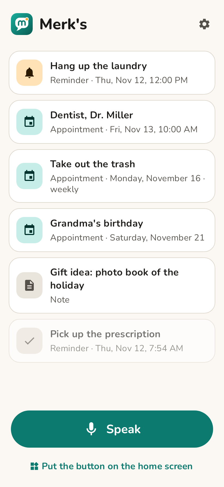

# Merk's

Tap once, say it, done. Merk's is an Android app for people who do not want to open an app, type, or think about where something belongs.

A home screen widget starts listening right away. What you say is sorted into an appointment, a reminder or a note. Appointments go into the phone calendar, and the app notifies you in time. The app speaks English and German.

<p>
  
  
  
  
</p>

## Install

Download `merks.apk` from the [latest release](https://github.com/Silvertax/merks/releases/latest) and open it. Updates install over older versions; your entries are kept. The app tells you when a new version is out (once a day it asks GitHub; this can be switched off).

## How it works

1. Tap the widget (or the "Speak" button in the app).
2. Speak, for example "Tomorrow at 10 dentist" or "Remind me in 20 minutes to take the laundry out".
3. The app shows what it understood. "Undo" removes it again.

While listening, only a small card appears at the bottom of the screen; afterwards a notification shows what was saved, with an undo button. This can be switched to a full-screen view in the settings.

Series work too: "Every Monday take out the trash", "Every day at 8 am take pills", "Every two weeks on Friday at 3 pm foot care", "Every year on December 3rd grandma's birthday". They become repeating calendar events.

Notifications: reminders fire at their time, appointments one hour ahead, all-day entries at 8:00. Appointments also notify at 6 pm on the day before (can be switched off). Each notification offers "Done", "In 15 min" and "In 1 hr".

The widget is 2x2 by default and can be resized down to 1x1. The app follows the phone's light or dark mode; an OLED mode gives a pure black background.

## Language

The app follows the phone: German phones get German, all others English. The language can also be chosen in the settings (on Android 13 and newer also in the system's app language settings). Speech recognition and the offline rules use the app's language.

## Sorting

- **Offline rules** (default): recognise common date, time and repeat phrases in English and German. No account, no internet for the sorting step.
- **AI** (optional): enter an Anthropic API key in the settings. The spoken text is then sent to the Anthropic API, which also copes with free-form speech. The model can be changed (default `claude-haiku-5-5`); key and model are checked as soon as a field is left, spellings like "Sonnet 5.5" become the model ID, and an unknown name goes back to the default. A test button and a status line show whether it works. If a request fails, the offline rules take over.

Speech-to-text uses the recogniser installed on the phone (`SpeechRecognizer`). Whether that works offline depends on the phone.

## Status

Version 0.5.0 is an early test version.

## Build

```
./gradlew testDebugUnitTest assembleRelease
```

Requires JDK 21 and the Android SDK (platform 35).

## Releasing

1. Raise `versionCode` and `versionName` in `app/build.gradle.kts`.
2. Describe the changes in a new section `## <version>` of `CHANGELOG.md`.
3. Create a GitHub release with the tag `v<version>`. Title and description can stay empty.

The Build workflow then checks that the tag matches the app version, runs the tests, builds and signs `merks.apk`, attaches it to the release and fills in an empty title and description. The description comes from `CHANGELOG.md`, or from the commit messages if the changelog has no section for the version.

## Tests

`./gradlew testDebugUnitTest` runs the unit tests and the app tests in a simulated Android 15 (Robolectric), in German and English: update from an old database, speaking to confirmation, calendar series, reminder buttons, settings, language choice, list and widget. Nothing goes to the network.

`MERKS_LIVE=1 ./gradlew testDebugUnitTest --tests '*LiveApiTest'` also talks to the real Anthropic API; with `MERKS_API_KEY` set it checks a working key as well. `MERKS_SCREENSHOTS=<folder>` (with `MERKS_SCREENSHOTS_LANG=en` for English) renders the screens as PNG files. Release signing reads `MERKS_KEYSTORE`, `MERKS_KEYSTORE_PASSWORD`, `MERKS_KEY_ALIAS` and `MERKS_KEY_PASSWORD` from the environment; without them the debug key is used.

## License

MIT, see [LICENSE](LICENSE). The Nunito font is licensed under the SIL Open Font License, see [fonts/Nunito-OFL.txt](fonts/Nunito-OFL.txt).
